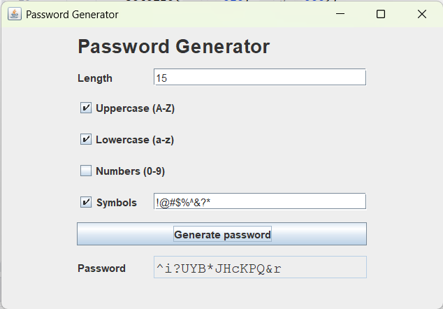

### Password Generator

Program to generate a random password from options entered by the user.
The user chooses the password length and whether to include uppercase letters, lowercase letters, numbers, and which symbols.
The generated password is then displayed in the UI.

### Screenshots

#### Links

- [Gson](https://github.com/google/gson)
- [JUnit](https://junit.org/)
- [GridBagLayout](https://docs.oracle.com/javase/8/docs/api/java/awt/GridBagLayout.html)

Looked at these to see what the app is meant to mimic:
- [1Password Password Generator](https://1password.com/password-generator)
- [RoboForm Password Generator](https://www.roboform.com/password-generator)